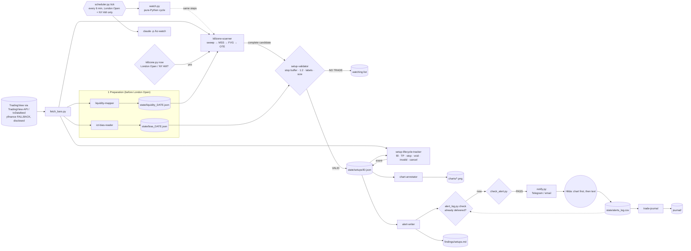

# ict-entry-model-studio

A Claude Code project that watches **NAS100, XAUUSD, EURUSD and GBPUSD** (with **DXY** as confluence) for **ICT entry setups**
during the kill zones, and writes an alert for every valid setup and every status change: fill, TP1, TP2, stop, breakeven,
void, invalid, cancelled. Each alert names the model and its Charter stage and comes with a marked-up chart.

Kill zones are defined in New York time and reported in **SAST (Africa/Johannesburg)**, with the DST change handled by script.

> ⚠️ **Analysis only, not financial advice.** This project never places, changes or cancels orders. It has no broker code, and a test fails if any is added.

Inspired by the structure of [GdotAiM/ict-content-studio](https://github.com/GdotAiM/ict-content-studio): agent files with YAML front matter and an SOP, skills with references and deterministic Python scripts, state files, pytest and CI. This project applies that pattern to a different job, watching for live entry models, and its content is original.

## Architecture

- **Deterministic core:** kill-zone times, detection, stop and R:R checks, sizing, lifecycle, dedupe and charts are all Python scripts. The model never works out R:R or SAST times itself.
- **Gates:** `validate_setup.py` must return VALID and `check_alert.py` must PASS before anything is sent. `alert_log.py` blocks re-sends.
- **Silent on no change:** a cycle with no new event sends nothing.

## Layout
```
CLAUDE.md                          hard rules (analysis only, never invent prices, stop/R:R/risk/labels, dedupe)
config/instruments.json            symbols, yfinance proxies, stop_buffer (spread + 1m wick, DEFAULTS), block_on_fallback, risk, watched kill zones
config/instruments.local.json      (git-ignored) your broker's spreads, merged over the defaults
lib/emconfig.py                    config loader shared by the scripts
.env.example                       notifier / runner settings template (copy to .env, git-ignored)
.claude/agents/                    8 subagents (YAML front matter + SOP)
  ict-bias-reader  liquidity-mapper  killzone-scanner  setup-validator
  setup-lifecycle-tracker  chart-annotator  alert-writer  trade-journal
.claude/commands/                  /kz-watch  /morning-prep  /recap
.claude/skills/
  killzones/scripts/killzone.py              NY → SAST kill zones, DST-correct; "are we in a watched kill zone?"
  market-data/scripts/fetch_bars.py          TradingView-API (Node) then tvDatafeed, yfinance FALLBACK flagged, NO DATA = stop
  ict-bias/scripts/mtf_bias.py               M/W/D structure, dealing range, draw on liquidity → bias + confidence + reasons
  liquidity/scripts/liquidity_levels.py      PDH/PDL, Asia range, week extremes, equal highs/lows, swept?
  setup-detection/scripts/detect.py          swings, sweep/turtle soup, displacement, FVG, MSS, OTE, entry suggestion
  setup-detection/scripts/models.py          Unicorn (breaker + FVG), Charter M1–M13 checks, model naming, Charter stage
  risk-rules/scripts/validate_setup.py       stop buffer, 1:2, TP1 partial, COUNTER-TREND label
  risk-rules/scripts/position_size.py        0.5% standalone; 0.25% correlated, max 4, 1% group
  alert-format/scripts/render_alert.py       fixed alert wording (NEW + every status event)
  alert-format/scripts/check_alert.py        alert gate (fields, labels, FALLBACK disclosure, banned language)
  chart-markup/scripts/render_chart.py       matplotlib chart: sweep, MSS, FVG, OTE, entry, stop, targets
  ict-entry-models/references/               core model, ICT 2022 model, Unicorn, Charter models 1–13, glossary
tools/tradingview-bridge/               bridge.mjs + package.json: read-only candle fetch via Mathieu2301/TradingView-API
scripts/watch.py                   one full watch cycle in pure Python (lifecycle → scan → outbox → setups.md)
scripts/scheduler.py               every ~6 min in watched kill zones only (NY time → SAST, DST-correct), python or claude runner
scripts/notify.py                  Telegram Bot API and/or SMTP; chart first; logs delivered only on success
scripts/lifecycle.py               pending → filled → TP1/TP2/stop; void / invalid / cancelled
scripts/alert_log.py               dedupe log (a row = delivered)
scripts/write_setups_md.py         findings/setups.md with "Updated: YYYY-MM-DD HH:MM SAST"
scripts/recap.py                   R by setup / instrument / session / model / bias label
state/alerts_log.csv, SCHEMA.md    state (setups/*.json are git-ignored)
examples/                          EXAMPLE DATA (FABRICATED) used by tests and CI
tests/                             pytest (no network)
```

## Setup
1. Install [Claude Code](https://docs.claude.com/en/docs/claude-code) and log in.
2. `cd ict-entry-model-studio`. You need Python 3.10 or newer. The core scripts use only the standard library.
3. Tests: `pip install -r requirements-dev.txt && pytest -q`
4. Live data: `pip install pandas matplotlib yfinance`, then a TradingView backend (neither needs a TradingView login; data may be delayed and can time out):
   - **TradingView-API** ([Mathieu2301/TradingView-API](https://github.com/Mathieu2301/TradingView-API), tried first): needs Node 20.19+. Run `cd tools/tradingview-bridge && npm install` once. The bridge (`bridge.mjs`) only calls `getCandles`, anonymously, and prints JSON. It is read-only like the rest of the project.
   - **tvDatafeed** (second): `pip install git+https://github.com/rongardF/tvdatafeed.git`.
   - `TV_BACKEND=auto|node|tvdatafeed` in `.env` forces one. Either one counts as TradingView data; the bar metadata and alerts name the backend that answered. Only when both fail does the yfinance FALLBACK (or NO DATA for NAS100 / XAUUSD) apply.
   - Anonymous TradingView-API access is limited (the library reports about 7,000 one-minute bars), which is more than the 1,000 this project requests.
5. Stop buffers: the `stop_buffer` values in `config/instruments.json` are **defaults pending your broker's spreads**. Put your real
   spread and normal 1m wick per instrument in `config/instruments.local.json` (git-ignored), for example
   `{"instruments": {"NAS100": {"stop_buffer": {"spread": 2.0, "wick_1m": 7.0, "status": "my broker, Nov 2026"}}}}`.
6. Alerts to your phone: `cp .env.example .env` and fill in Telegram and/or SMTP (see [Notifications](#notifications)).
7. Optional: `export TEAM_FINDINGS_DIR=/path/to/findings` so the bias reader and liquidity mapper also read a wider team's `bias.md`, `liquidity.md` and `intermarket.md`, and flag any that are stale.
8. Run `claude` in the repo root. Claude Code loads `CLAUDE.md`, `.claude/agents/`, `.claude/skills/` and `.claude/commands/` automatically. Check with `/agents`.

## Daily workflow (SAST, weekdays)
| SAST (US winter / EST) | SAST (US summer / EDT) | Step |
|---|---|---|
| ~08:30 | ~07:30 | `/morning-prep`: daily bias and liquidity map (Charter stage 1, Preparation) |
| 09:00–12:00 | 08:00–11:00 | **London Open**: the scheduler runs `watch.py` (or `/kz-watch`) every 6 minutes |
| 14:00–17:00 | 13:00–16:00 | **NY AM**: same. The close-out run at 17:00 (EST season) cancels unfilled setups |
| after NY AM | after NY AM | `/recap today`; Saturday `/recap this week` |

Always check the times with `python3 .claude/skills/killzones/scripts/killzone.py table --date <today>`.
The other kill zones (Asian, Silver Bullet, London Close, NY PM) are computed too, but they aren't scanned by default to keep runs small. Add them to `watch_killzones` if you want them.

## Scheduling
`scripts/scheduler.py` decides *when* to run. It computes the London Open and NY AM windows in New York time each day and converts them
to SAST, so the US clock change is handled for you. Slots are every 6 minutes from the start of each window, plus one close-out run at
the end minute that cancels unfilled setups. NY weekends are skipped. A slot runs once even if cron fires twice, and a lock stops
overlapping runs.
```bash
python3 scripts/scheduler.py windows            # today's windows (NY and SAST)
python3 scripts/scheduler.py next --count 6     # next run times in SAST
python3 scripts/scheduler.py tick               # run if this minute is due (for cron / systemd / Task Scheduler)
python3 scripts/scheduler.py loop               # or keep it running in a terminal / tmux
```
Runners: `--runner python` (default) runs `scripts/watch.py`, which is pure Python and doesn't need Claude.
`--runner claude` runs `claude -p "/kz-watch" $CLAUDE_ARGS` so Claude Code's agents do the cycle. Headless Claude needs tool permissions;
set them in `.claude/settings.json` or `CLAUDE_ARGS`, as described in Claude Code's docs for your version.

**Linux / macOS (cron).** Run `tick` every 6 minutes on weekdays. It does nothing outside the windows, so the crontab never needs changing for DST:
```
*/6 * * * 1-5  cd $HOME/ict-entry-model-studio && /usr/bin/python3 scripts/scheduler.py tick >> state/scheduler.log 2>&1
```
**Linux (systemd user timer):**
```ini
# ~/.config/systemd/user/kz-watch.service
[Service]
Type=oneshot
WorkingDirectory=%h/ict-entry-model-studio
ExecStart=/usr/bin/python3 scripts/scheduler.py tick
# ~/.config/systemd/user/kz-watch.timer
[Timer]
OnCalendar=Mon..Fri *:0/6
Persistent=false
[Install]
WantedBy=timers.target
```
Then run `systemctl --user daemon-reload && systemctl --user enable --now kz-watch.timer`. On a server, also run `loginctl enable-linger $USER`.

**Windows (Task Scheduler).** In Command Prompt (cmd.exe):
```bat
schtasks /Create /TN "ICT kz-watch" /SC MINUTE /MO 6 /TR "\"C:\Path\To\python.exe\" \"C:\Users\you\ict-entry-model-studio\scripts\scheduler.py\" tick"
```
This runs `tick` every 6 minutes all day; `tick` exits immediately outside the kill zones and on weekends. Install `tzdata` (`pip install tzdata`), because Windows Python has no time-zone database.

## Notifications
`scripts/notify.py` sends the chart first and then the text, via the Telegram Bot API and/or SMTP email. It's configured only through
environment variables or a git-ignored `.env` file (template: [.env.example](.env.example)):
`TELEGRAM_BOT_TOKEN`, `TELEGRAM_CHAT_ID`, `SMTP_HOST`, `SMTP_PORT`, `SMTP_SECURITY` (starttls/ssl/none), `SMTP_USER`, `SMTP_PASSWORD`,
`SMTP_FROM`, `SMTP_TO`, and optionally `NOTIFY_CHANNELS`.
```bash
python3 scripts/notify.py --check-config
python3 scripts/notify.py --alert alerts/2026-11-12_N1_NEW.md --chart charts/nas_N1_1112_new.png --id N1 --event NEW --dry-run
```
- **Dedupe:** if `state/alerts_log.csv` already has (setup_id, event), nothing is sent.
- **Logging:** the row is written only when at least one channel succeeded. Dry runs never log.
- **Retries:** a failed delivery stays in the outbox, and `watch.py` retries it next cycle in order, so a FILLED never arrives before its NEW. Events older than 6 hours expire instead of being sent late.
- **No secrets in the repo:** the notifier only sends messages. It has no trading code and never will.

## Model detection and bias
- **Bias:** `mtf_bias.py` reads monthly, weekly and daily structure (weighted 1, 1.5 and 2), checks premium or discount in the 20-day dealing range (with an EXTENDED warning), finds the draw on liquidity (untaken PDH/PDL, PWH/PWL, PMH/PML and old highs/lows), and cross-checks DXY. It outputs the bias, a confidence score, an invalidation level and its reasoning.
- **Models:** `models.py` names the Unicorn (a breaker block overlapping an FVG inside the OTE), the ICT 2022 model, or the core model. It also scores Charter models M1–M13 as detected, partial, not detected, insufficient data or not mechanical. M3 and M4 need COT data and seasonality, which this project doesn't have, so they are never claimed. Pip targets are only checked on FX. The full honesty table is in [charter-detection.md](.claude/skills/ict-entry-models/references/charter-detection.md).

## Example prompts
| Agent / command | Prompt |
|---|---|
| ict-bias-reader | "Use ict-bias-reader for today." |
| liquidity-mapper | "Use liquidity-mapper for NAS100 and XAUUSD, equal-high tolerance 3 points on NAS." |
| killzone-scanner | "Run killzone-scanner now for all four instruments." |
| setup-validator | "Use setup-validator on drafts/candidate_NAS100_1051.json. Bias is bull." |
| setup-lifecycle-tracker | "Use setup-lifecycle-tracker on all open setups." |
| chart-annotator | "Use chart-annotator for N6 TP1." |
| alert-writer | "Use alert-writer for N6 STOP at 12:44, 1m high 28248.8." |
| trade-journal | "Use trade-journal for this week; split with-bias vs COUNTER-TREND." |
| /kz-watch | `/kz-watch` |
| watch.py | `python3 scripts/watch.py --dry-run` (no Claude; preview without sending) |
| ad hoc | "Is the 28239 raid + MSS on NAS a valid short with entry 28219 and TP1 28159.4? Run the validator." |

Run the scripts directly:
```bash
python3 .claude/skills/killzones/scripts/killzone.py table --date 2026-11-12
python3 .claude/skills/market-data/scripts/fetch_bars.py NAS100 1m --bars 600 --out drafts/bars/NAS100_1m.csv
python3 .claude/skills/setup-detection/scripts/detect.py --csv drafts/bars/NAS100_1m.csv --direction short --level 28167.1
python3 .claude/skills/risk-rules/scripts/validate_setup.py --instrument NAS100 --direction short --entry 28219 --raid-extreme 28239 --tp 28159.4 --tp 28108.7 --bias bull
python3 .claude/skills/risk-rules/scripts/position_size.py --risk-pts 29 --equity 10000
python3 scripts/lifecycle.py --setup state/setups/N6.json --bars drafts/bars/NAS100_1m.csv --write
python3 scripts/alert_log.py check --id N6 --event TP1
python3 scripts/recap.py --from 2026-11-09
```
A full offline walkthrough on fabricated data is in [examples/README.md](examples/README.md).

## Rules encoded
- **Sequence:** liquidity sweep or turtle soup, then a market structure shift with displacement, then an FVG, then entry at the FVG or in the OTE zone (62–79%). Models: the core sequence, the ICT 2022 model, the Unicorn, and Charter Price Action Models 1–13 with the 5-stage plan.
- **Stop:** at least spread plus a normal 1m wick beyond the raid extreme. If that pushes R:R under 1:2, there's no trade.
- **R:R:** minimum 1:2. A TP1 under 2R is flagged PARTIAL only.
- **Risk:** 0.5% standalone. Correlated trades are 0.25% each, up to 4, with a 1% group maximum.
- **Labels:** a setup against the daily bias is labelled COUNTER-TREND.
- **Closed bars only:** a bar is used only once it has closed (a 09:31 bar is available from 09:32:00). The forming bar is never scanned or used for fills and stops.
- **Lifecycle:** a setup is void if TP1 trades before the fill, invalid if the raid extreme breaks before the fill, and cancelled at the end of the kill zone if unfilled. Ambiguous bars count as a stop first. A gap through the stop fills at the bar's open.
- **Data:** TradingView first. yfinance is a fallback only and is always disclosed. For NAS100 and XAUUSD the fallback is *blocked* (the proxies are futures, NQ=F and GC=F, whose basis to the OANDA CFD can exceed the stop buffer), so those instruments report NO DATA instead; set `"block_on_fallback": false` in `config/instruments.local.json` to allow a disclosed fallback. Prices are never invented.

## License
MIT. See [LICENSE](LICENSE). This project is not affiliated with ICT or TradingView.
